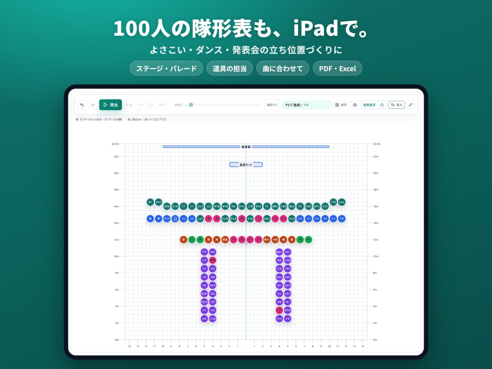
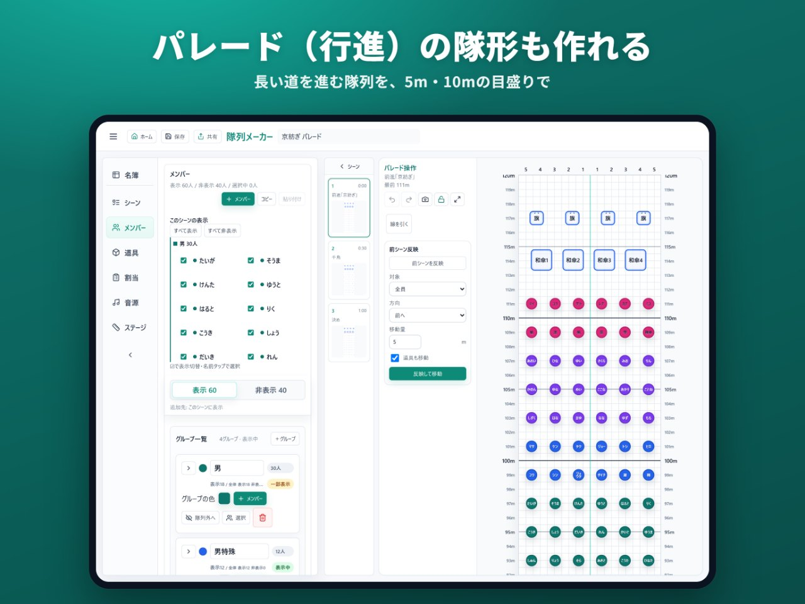
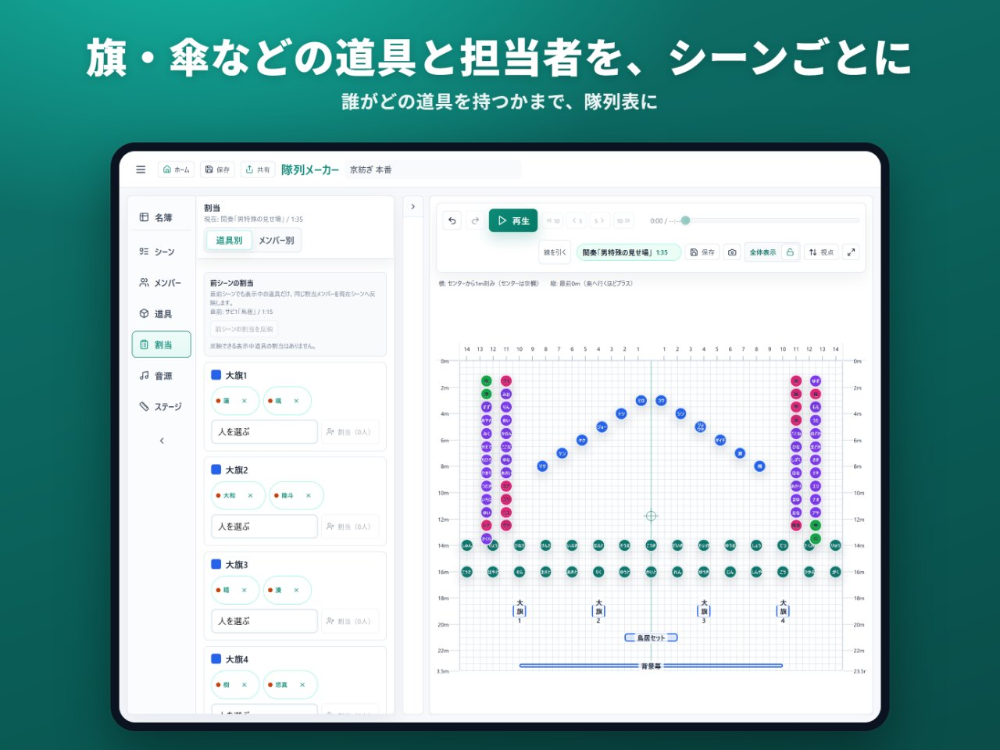
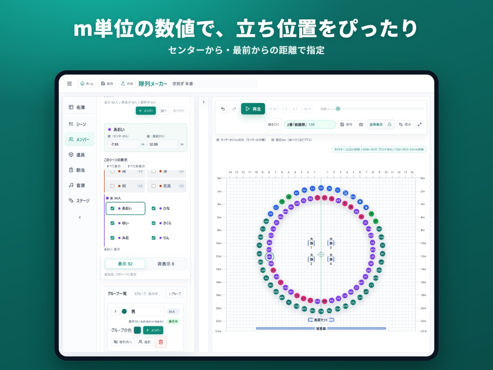
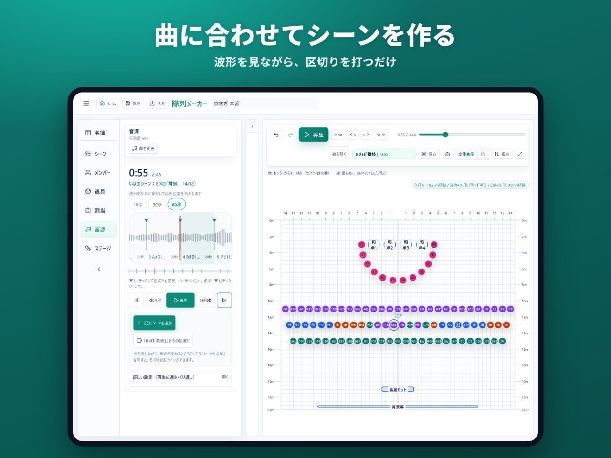
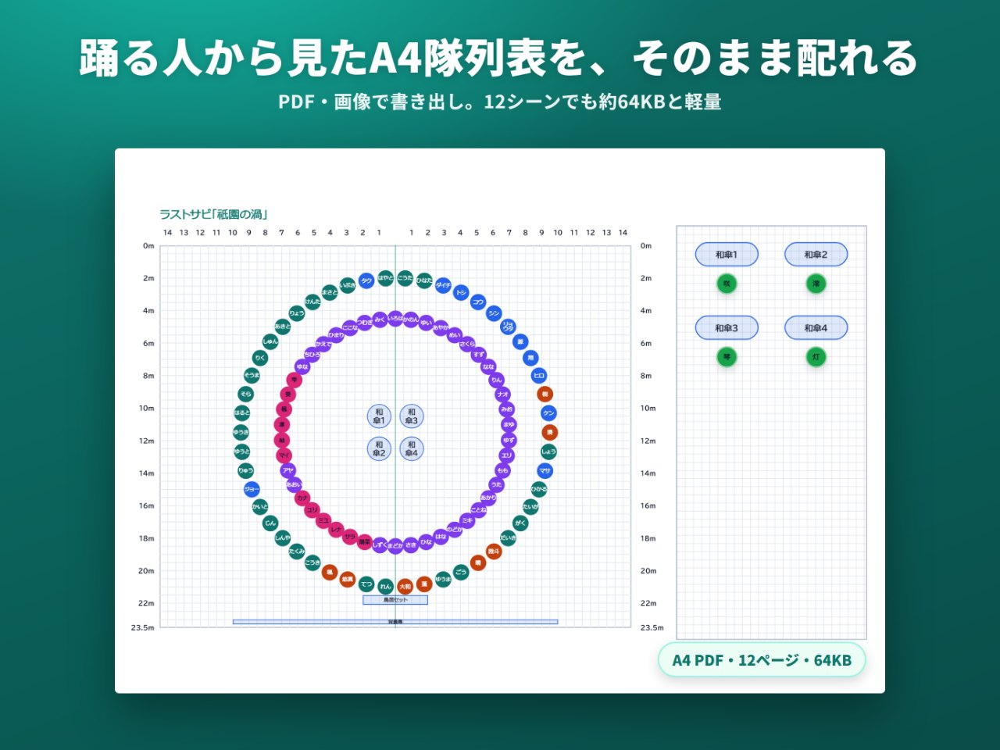
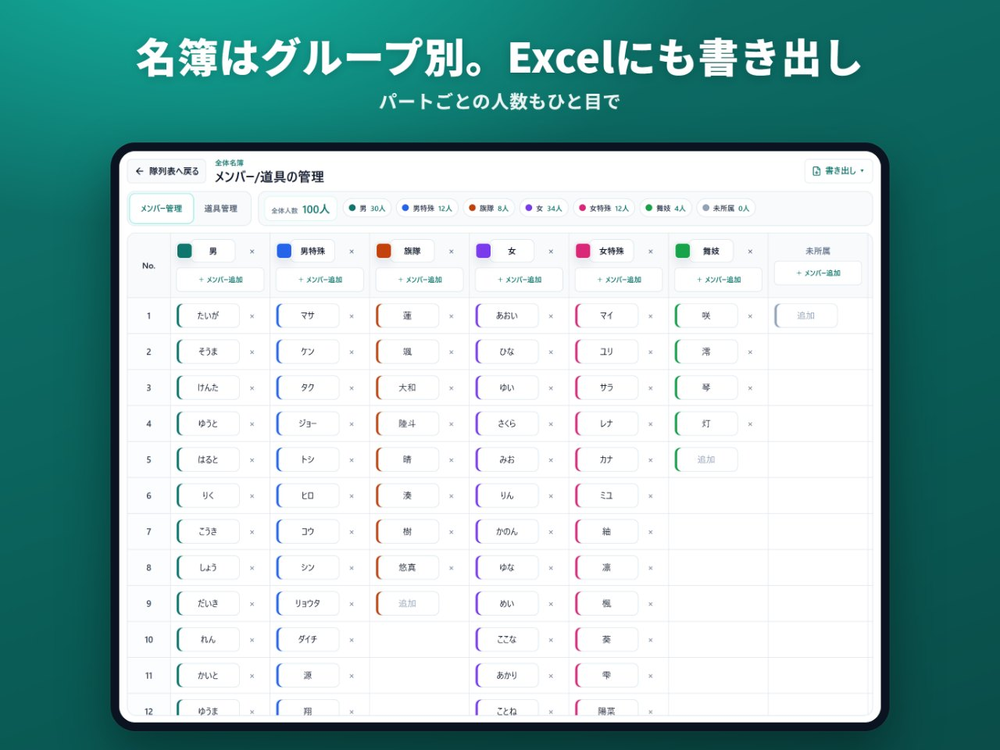
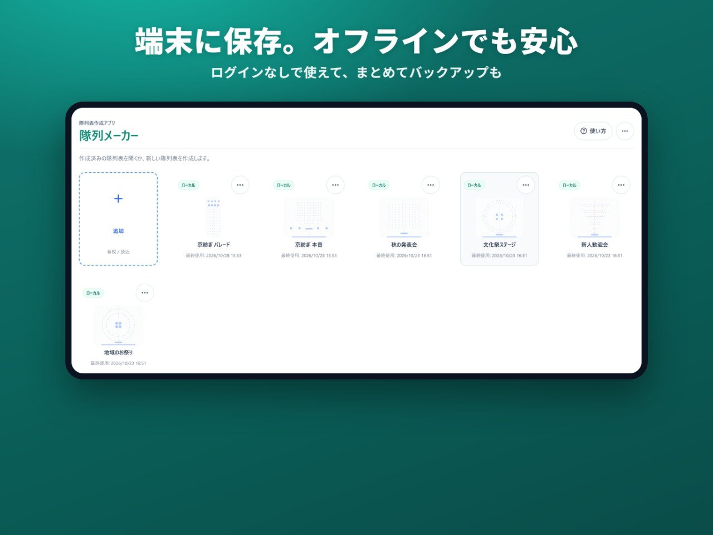

# 隊列メーカー

**よさこい・ダンス・発表会の「立ち位置づくり」を、iPad ひとつで。**

[App Store でダウンロード（iPad・無料）](https://apps.apple.com/jp/app/id6797357395) ・ [Web 版をブラウザで使う](https://tairetsu-maker.vercel.app/) ・ [サポート](https://tairetsu-maker.vercel.app/support.html)

---

## どんなアプリ？

ダンスやよさこいの「隊列表／フォーメーション」（曲のどこで、だれが、どこに立つか）を作るアプリです。

- 100人を超えるチームでも、シーンごとの立ち位置をまとめて作れる
- 大旗や和傘などの道具と、「だれが持つか」まで書き込める
- 曲の波形を見ながら、シーンを区切れる
- できた隊列表は、12シーンでも約64KBの軽い PDF に。LINE でそのまま配れる
- 端末に保存するので、電波がない所でも使える
- ログインすれば、最大8人で同時に編集できる

料金は無料です。iPad アプリ（iPadOS 15 以上）のほか、パソコンなどのブラウザで使える Web 版もあります。ログインなしですぐに使えます。

---

## できること

### ステージも、パレード（行進）も

決まった大きさのステージだけでなく、長い道を進むパレードの隊形も作れます。5m・10m ごとの目盛りで、距離が一目で分かります。

### 道具と、その担当まで

大旗や和傘などの道具を置き、「だれがどの道具を持つか」まで隊列表に書き込めます。

### 立ち位置を数値でぴったり

「センターから右へ何m・最前から何m」と、m 単位の数値でも置けます。

### 曲に合わせてシーンを作る

曲の波形を見ながら区切りを打つだけで、その時刻のシーンができます。

### 踊る人の目線で、軽い PDF に

隊列表は、踊る人から見た向きで A4 の PDF や画像にできます（客席から見た向きも選べます）。PDF はとても軽く、12シーンでも約64KB です。LINE で送っても、相手の通信量をほとんど使いません。

### 名簿はグループ別に。Excel にも

メンバーをパートやグループごとに管理できます。名簿は Excel ファイルでも書き出せます。

### 端末に保存。オフラインでも安心

隊列表は iPad の中に保存されるので、電波がない所でも使えます。まとめてバックアップすることもできます。

### みんなで同時に編集

ログインすると、最大8人まで同じ隊列表を同時に編集できます。招待リンクを送るだけで参加でき、アプリを持っていない人も Web 版から加われます。

---

## 最近の更新

**1.1.1**

- PDF のファイルサイズを最大99%削減（約100分の1）。拡大しても線や文字がくっきり
- 名簿の PDF を Excel と同じ表の形に
- 書き出すときに「踊る人から見た向き／観客から見た向き」を選べるように
- ステージの設定をシンプルに

---

使っている技術（開発者の方へ）

| 領域 | 使ったもの |
| --- | --- |
| 画面 | React、TypeScript |
| iPad アプリ | Capacitor、Swift（端末の保存は SQLite） |
| クラウド・同時編集 | Supabase、Yjs |
| 書き出し | jsPDF、HarfBuzz（使う文字だけのフォントを作って PDF を軽く） |
| 配信 | App Store、Vercel（Web 版） |

アプリ本体のソースコードは公開していません。

---

- ご意見・不具合の報告は [サポートページ](https://tairetsu-maker.vercel.app/support.html) からどうぞ。
- [プライバシーポリシー](https://tairetsu-maker.vercel.app/privacy.html) ・ [利用規約](https://tairetsu-maker.vercel.app/terms.html)
- © 2026 隊列メーカー
